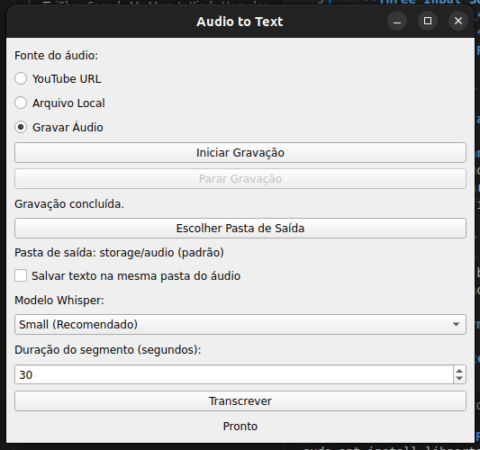

# 🎙️ Audio to Text – YouTube, Local Files & Live Recording

A desktop app (Windows and Linux) that transcribes audio into text with OpenAI's
Whisper. The audio can come from a **YouTube video**, a **local media file** or a
**live recording** (microphone or the computer's own sound output).



## ✨ Features

- **Three input sources**
  - **YouTube URL** – downloads the audio with `yt-dlp` and names the file after the video title.
  - **Local file** – `.mp3`, `.wav`, `.ogg`, `.m4a`, `.mp4`, `.avi`, `.mov`.
  - **Recording** – from a microphone or from the system output (Stereo Mix on Windows, `monitor` devices on Linux).
- **Whisper model choice** – Tiny, Base, Small (default), Medium or Large.
- **Segmented transcription** – the audio is split into chunks (10–600 s, default 30 s) so the progress bar can follow the work.
- **Output** – one `.txt` per audio file, in `storage/text/` or next to the audio.

## 📋 Requirements

| | Windows | Linux (Debian/Ubuntu) |
|---|---|---|
| Python | 3.10 ([python.org](https://www.python.org/downloads/)) | 3.10 (`sudo apt install python3 python3-venv`) |
| FFmpeg | see below | `sudo apt install ffmpeg` |
| PortAudio (recording only) | bundled with `sounddevice` | `sudo apt install libportaudio2` |

The app was tested with Python 3.10.11. Whisper does not support every recent Python release, so check
[its setup notes](https://github.com/openai/whisper#setup) before using a newer one.

### FFmpeg on Windows

Use either of these options:

- `winget install Gyan.FFmpeg` (or download it from [ffmpeg.org](https://ffmpeg.org/download.html)), then
  open a **new** terminal and check with `ffmpeg -version`.
- Put `ffmpeg.exe` in the app folder (next to `app.py`, or next to `app.exe` when using the build). The
  app searches its own folder before the `PATH`.

## 🚀 Installation

```bash
git clone https://github.com/FocusEvenGitHub/transcript-audio-yt.git
cd transcript-audio-yt
```

Then just run the launcher:

- **Windows** – double-click `run.bat` (or run it from a terminal).
- **Linux** – `./run.sh` (if needed, first run `chmod +x run.sh`).

The first run creates the `venv` (with Python 3.10 on Windows, through the `py` launcher) and installs
`requirements.txt`. That run is slow, because `openai-whisper` installs PyTorch. Later runs only check
the dependencies (a few seconds) and open the app. The launcher also warns you if FFmpeg is not found.
On Linux, `PYTHON=python3.10 ./run.sh` picks a specific Python.

The first time each Whisper model is used, it is downloaded too (from about 75 MB for `tiny` up to
about 3 GB for `large`).

<details>
<summary>Manual setup (without the launcher)</summary>

```bash
py -3.10 -m venv venv          # Linux: python3 -m venv venv
venv\Scripts\activate          # Linux / Git Bash: source venv/bin/activate (Git Bash: venv/Scripts/activate)
pip install -r requirements.txt
python app.py
```

</details>

## 🖥️ Usage

1. Choose the source:
   - **YouTube URL** – paste the link.
   - **Arquivo Local** – click **Selecionar Arquivo**.
   - **Gravar Áudio** – choose the device, then click **Iniciar Gravação** and **Parar Gravação**.
2. Optionally set:
   - **Escolher Pasta de Saída** – where the audio is saved (default: `storage/audio`).
   - **Salvar texto na mesma pasta do áudio** – saves the `.txt` next to the audio instead of in `storage/text`.
   - **Modelo Whisper** – larger models are more accurate but slower.
   - **Duração do segmento** – the chunk length in seconds.
3. Click **Transcrever**. When it finishes, a dialog shows the path of the `.txt` file.

Your original files are never moved or renamed: a local file is copied (or converted to WAV) into the
audio folder. Recordings are saved straight into the audio folder as `gravacao_YYYYMMDD_HHMMSS.wav`.

### Recording the computer's sound

- **Windows** – choose **Mixagem estéreo / Stereo Mix**. If it is not listed, enable it in
  *Settings → Sound → More sound settings → Recording* (right-click → *Show disabled devices*).
  Some sound drivers do not offer it.
- **Linux (PulseAudio/PipeWire)** – choose a device with `monitor` in its name, or choose `default`
  and switch the app's input to the monitor in `pavucontrol`.

On Windows each device appears once for each audio API (`[MME]`, `[Windows WASAPI]`, …). Any of them
works, and `MME` is usually the safest choice.

## ⚙️ Configuration

The app reads `config.json` from its own folder. **The file is required**: if it is missing, the app
does not start.

```json
{
    "storage": "storage",
    "audio_folder": "storage/audio",
    "text_folder": "storage/text",
    "supported_formats": [".mp3", ".wav", ".ogg", ".m4a", ".mp4", ".avi", ".mov"],
    "download_retries": 10,
    "whisper_models": {
        "Tiny (Mais rápido)": "tiny",
        "Base": "base",
        "Small (Recomendado)": "small",
        "Medium": "medium",
        "Large (Melhor qualidade)": "large"
    },
    "default_model": "small"
}
```

The `storage` folders and the `app.log` file are created in the **current working directory**.

### YouTube cookies (optional)

Some videos (for example, age-restricted ones) only download when you are logged in. Export your
browser cookies to a `cookies.txt` file ([how to](https://github.com/yt-dlp/yt-dlp/wiki/FAQ#how-do-i-pass-cookies-to-yt-dlp))
and place it next to `app.py`, or in the folder you run the app from.

> ⚠️ `cookies.txt` holds your Google session. It is in `.gitignore`: never commit it, and never
> include it in the build (`app.spec`), because it would end up inside the `.exe`.

## 🏗️ Building an executable

```bash
pip install pyinstaller
pyinstaller app.spec
```

Run it **with the venv activated**, so the build uses the venv's Python and packages. It takes a few
minutes and produces `dist/app.exe` on Windows or `dist/app` on Linux (about 220 MB, mostly PyTorch),
as a single file with no console window. The first launch takes about 20 s while the bundle is
extracted.

`config.json` and Whisper's data files are bundled. FFmpeg is **not** bundled: install it or put
`ffmpeg.exe` next to the executable. On Windows the build bundles the Visual C++ runtime from the build
machine's `System32`, so build on a machine with an up-to-date
[VC++ Redistributable](https://learn.microsoft.com/cpp/windows/latest-supported-vc-redist).

## ❗ Troubleshooting

- **"Gravar Áudio" is disabled** – `sounddevice` is not installed (Windows), or PortAudio is missing
  (Linux: `sudo apt install libportaudio2`).
- **FFmpeg errors** – run `ffmpeg -version` in a new terminal. On Windows you can also put `ffmpeg.exe`
  next to the app.
- **Download fails** – the error dialog shows yt-dlp's own message. Update `yt-dlp`
  (`venv\Scripts\python -m pip install -U yt-dlp`), because YouTube changes often, and try `cookies.txt`.
- **Recording fails with "Invalid sample rate"** – try the same device under another API (`[MME]`).
- **The model download fails** – Whisper downloads models from the internet the first time each one is
  used, and caches them in `~/.cache/whisper`.
